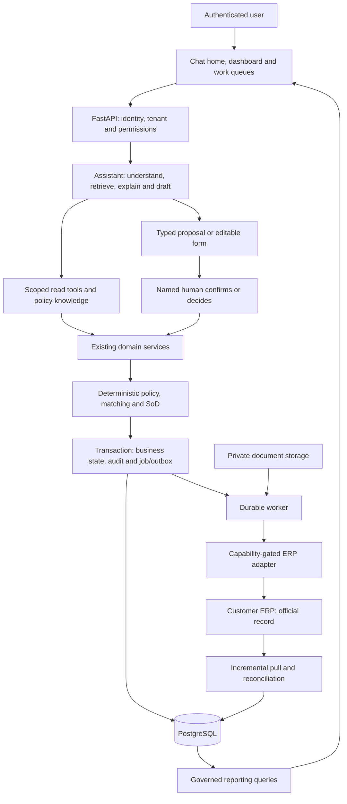

# Orrfin: competitor research and proposed platform plan

Research date: **21 October 2026 (Asia/Kolkata)**. Status: **planning proposal, not an approved replacement for BUILD_PLAN**. No application code, infrastructure, ERP records, installations, or protected BUILD_PLAN sections were changed for this research.

## 1. Decision

**Yes: build an independently designed procurement and finance-control platform around customers' existing ERPs, using the public capabilities of these competitors as research inputs. No: do not plan on recovering their complete private systems or combining their proprietary implementations.**

The achievable shortcut is to reuse Orrfin's existing application, established procurement workflows, official ERP APIs, licensed components, and disciplined AI-assisted development. Competitor research reduces product-discovery uncertainty; it does not remove integration engineering, accounting decisions, operational support, or validation.

The proposed product statement is:

> Orrfin is the conversational workspace for requesting, reviewing, and controlling purchases and invoices across an existing ERP. Every answer has evidence, every important action has a named decision-maker, and every ERP write has a traceable outcome.

Your requested chat-first experience fits this direction. “Do any kind of work” must resolve into a supported, permissioned business operation. A user can ask broadly; the software must make its supported scope explicit. The assistant must never invent a successful action or silently acquire approval authority.

“Replicate every competitor completely” conflicts with “do not build an ERP”: DualEntry sells a full accounting ERP, including a general ledger, revenue recognition, and other accounting systems. Its AP page explicitly says AP is not sold as a standalone product. Learn from its review and reporting experience while leaving accounting ownership in the customer's ERP. [DualEntry overview](https://www.dualentry.com/), [AP product and standalone-product FAQ](https://www.dualentry.com/core-financials/accounts-payable-automation).

## 2. What this investigation establishes

Evidence labels used below:

- **Public claim:** a vendor describes the capability; not a test of the product.
- **Observed:** directly visible in the browser or inspected in Orrfin's source.
- **Recorded result:** a saved test/evaluation report, not a test rerun today.
- **Proposed:** our independent design or recommendation.
- **Unknown:** information that public materials or the inspected source do not establish.

Reviewed the five supplied competitor sites, product and workflow pages, relevant published terms, REA/ECC/Vercel Skills documentation, official ERP documentation, and the local Orrfin repository linked to the supplied GitHub remote. Local HEAD was `0a50cba` (Step 27). The code-review graph reported a matching HEAD; its architecture community summary was sparse, so source and tests were used to verify the relevant boundaries.

Limits: no competitor private source, database, prompts, production telemetry, authenticated customer account, or complete product was inspected. Zycus direct page retrieval returned HTTP 403; its indexed official-page excerpts support only public-claim conclusions. Procure Ai's demo hub was inspected in the browser and presented a contact form before demo access. No form was submitted or account created. Chrome was unavailable through the browser connector; the available in-app browser was used. Zip's walkthrough page advertised access but did not establish an authenticated end-to-end trial. No present-day uptime or new test-pass claim is made about Orrfin.

Public websites cannot establish competitors' real isolation guarantees, exact schemas, workflow engines, recovery behavior, negotiated integrations, total implementation costs, or customer-specific configuration. Marketing accuracy and savings figures are not benchmarks for Orrfin.

## 3. What to learn from each competitor

| Competitor | Publicly supported capability pattern | Proposed lesson for Orrfin | Important boundary |
|---|---|---|---|
| Zip | Intake, configurable cross-functional workflows, P2P, supplier onboarding, sourcing, contract and risk orchestration | One request record with visible owners, approvals, blockers, and downstream ERP status | Its breadth does not prove that every integration is equally deep |
| DualEntry | Accounting ERP; AP capture/review, matching, reconciliation, close and conversational reporting | Evidence-based invoice review, period comparisons, actionable finance dashboards | GL, AR, revenue recognition and consolidation ownership remain in the ERP |
| Procure Ai | Conversational intake, spend analytics, sourcing/negotiation, supplier management; overlays ERP/S2P systems | Guided buying with explicit procurement context and supplier/history reuse | Autonomy claims are not permission to delegate Orrfin's controls to a model |
| Procol | P2P, catalogs, approvals, OCR-based three-way matching, vendor portal, sourcing and auctions | Supplier collaboration and a gradual sourcing extension after core P2P works | Portal tenancy and procurement competition rules require separate designs |
| Zycus | Intake and S2P orchestration, configurable policy routing, specialized agents, integrations | A coherent workflow and audit model across modules | Broad suite parity is a long-term program, not a beginner MVP |

Sources for these capability descriptions: [Zip product overview](https://zip.com/), [Zip workflow engine](https://zip.com/capabilities/workflow-engine), [DualEntry AP](https://www.dualentry.com/core-financials/accounts-payable-automation), [Procure Ai platform](https://www.procure.ai/platform), [Procol P2P](https://www.procol.ai/procure-to-pay-software/), [Zycus orchestration — indexed official text; direct access blocked](https://www.zycus.com/solution/procurement-orchestration).

Specific observations worth translating into requirements:

- Zip separates workflow configuration from individual requests and describes routing across ERP, legal, risk and IT tools. **Our design:** publish versioned approval templates; retain the version and decisions attached to each request. [Workflow engine](https://zip.com/capabilities/workflow-engine).
- Procure Ai describes dialog-based intake across purchasing, supplier, contract and sourcing requests. **Our design:** one conversational entry point, with different typed forms and permissions behind each supported request type. [Generative intake](https://www.procure.ai/platform/generative-intake-management).
- Procol's vendor portal describes ERP PO visibility, invoice upload, shipment notices, receipt status and credit/debit-note tracking. **Our design:** begin with supplier-specific PO visibility and invoice submission; defer logistics and credit-note breadth until their record ownership is defined. [Vendor portal](https://www.procol.ai/vendor-portal/).
- Procol describes demand grouping, editable RFP drafts, counteroffer suggestions and total-cost-based award recommendations. **Our design:** start with quote comparison and explicit human awards; do not start with autonomous negotiation. [Sourcing](https://www.procol.ai/autonomous-sourcing-software/).
- DualEntry demonstrates reporting concepts around conversational questions, variance narratives and drill-to-source. **Our design:** a governed metric catalog shared by chat and dashboards, with clear source freshness. [Reporting](https://www.dualentry.com/scale/financial-reporting-software).
- Zip's integration page distinguishes templates, an integration builder, MCP access, and APIs/files. **Our design:** distinguish the ERP adapter from an AI-facing tool interface; an MCP connector is not proof of accounting interoperability. [Integrations](https://zip.com/capabilities/integrations).

## 4. What already exists in Orrfin

The starting point is substantial. Preserve it and validate it before considering replacement.

| Area | Inspected evidence | Readiness interpretation |
|---|---|---|
| Application foundation | FastAPI, SQLAlchemy, PostgreSQL, Next.js; source and architecture inventory | Reuse the modular monolith |
| Procurement | Existing request/approval services; progress entries through Step 27 | Workflow exists; extend after regression verification |
| Matching and audit | Pure matching module, review services, audit events, documented deterministic controls | Core differentiator to preserve |
| ERP writes | `modules/erp_outbox/service.py`, PO handling, lost-reply failure tests | Durable protocol exists; per-ERP production semantics still need proof |
| Connectors | Eleven entries in `adapters/registry.py`; modes and capability gates | Eleven implementations do not equal eleven production-certified integrations |
| Assistant | Read-only tools bound to the user; port with six-round limit; service logs, link restrictions and rupee checks | Good foundation for safe answers; does not currently execute business commands |
| Intake drafting | `modules/assistant/drafts.py`, progress Step 24 | Draft-form experience already exists |
| Dashboards/rules/tasks | Insights, rules, workflows and budget modules; corresponding frontend routes | Extend and reconcile, rather than rebuild |
| Payments/bank/close/GST | Existing modules and Step 25–27 handoff entries | Simulated payments and bounded prototype controls; not production finance infrastructure |
| Landing experience | `frontend/src/app/page.tsx` redirects to `/home` | Current entry is the dashboard; proposed chat landing is a product change |
| Deployment | PROMPTS Steps 28–29 still pending in the supplied status | Finish deployment/rehearsal in approved order; this research does not deploy |

Relevant local evidence: [build plan](BUILD_PLAN.md), [progress](PROGRESS.md), [assistant decision](adr/0007-assistant-agent.md), [ERP research](ERP_CONNECTORS.md), [connection instructions](CONNECT_ERPS.md), [assistant tests](../backend/tests/integration/test_assistant.py), [bill recovery tests](../backend/tests/failure/test_bill_exactly_once.py), [connector registry](../backend/app/adapters/registry.py).

**Material gaps discovered:**

1. **Historical AI reliability is not launch-ready evidence.** The saved 15 October Gemini extraction report records 112/214 correct fields (52.3%), six file errors, and an injection case that did not pass because that file errored. This does not demonstrate a successful injection attack; it means the test did not establish a pass. The 19 October assistant report records 5/25 pass@1, with many unavailability failures. Separate provider availability from accuracy on successful responses, and rerun both on an appropriate evaluation set. [Extraction report](../evals/extraction/report-gemini.md), [assistant report](../evals/assistant/report-gemini.md).
2. **“Live” needs evidence attached to it.** The handoff log records a real local Odoo 19 exercise, but also unverified real-system Tally tags, Business Central mapping questions, SAP uncertainties and Zoho draft-bill gating. Preserve these distinctions in the product and pitch.
3. **Current multi-ERP does not mean multi-entity orchestration.** The approved model has one active connection per organization. Simultaneously routing several subsidiaries to several ERPs requires a new entity/connection-routing model, not just more connector cards.
4. **Rupee membership checks are not complete factual grounding.** The assistant can flag a rupee value absent from tool results, but a matching number can still be attached to the wrong invoice or period. Proposed improvement: render critical facts from typed results and validate fact-to-record relationships, dates, counts and currencies.
5. **Documentation has drift.** ARCHITECTURE's introductory status still says Step 1 while its module inventory is much newer; PROGRESS's opening summary lags later entries; older BUILD_PLAN statements about no payments, deferred TDS, PDF-only uploads and credentials coexist with later amendments. Reconcile these during the final review; do not treat the older lines as the current complete specification. This report leaves protected sections unchanged.

## 5. How to research and reimplement without private source

Use a capability-to-specification process. For each workflow:

1. Record a public source URL, retrieval date, evidence type and a short factual observation.
2. Identify the actor and business job: requester buys software; AP resolves a price discrepancy; supplier checks an invoice.
3. Write our own inputs, outputs, state transitions, permissions, exceptions and acceptance criteria.
4. Validate that specification with a procurement practitioner or accountant, using synthetic examples.
5. Map it onto existing Orrfin modules and official ERP contracts.
6. Create independent UI wireframes using Orrfin's brand, language and navigation.
7. Implement one vertical slice later; verify denial paths, outages and retries as carefully as success paths.
8. Compare user outcomes, not pixels: completion rate, elapsed time, manual touches, reconciliation differences, duplicate prevention and traceability.

Example independent requirement:

> When a software request exceeds the applicable approval tier, show its financial approvers and named IT reviewer before submission. Once submitted, preserve the policy version. If the amount changes materially, invalidate the affected approval and reroute. A person who prepared the request cannot approve it.

This is an Orrfin requirement. It does not assert that a competitor uses our schema, algorithm or state machine.

For deeper authorized demos, use the same synthetic scenario across products: request five laptops; revise quantity; partial receipt; excess invoice; duplicate invoice; missing receipt; rejected request; approver absent; supplier bank change; timeout after an ERP write; cross-entity access attempt. Record what the authorized UI actually demonstrates. Unobservable server behavior remains unknown. Do not misrepresent identity or submit trial forms as part of this research.

**Legal position:** “We changed it a little” is not legal clearance. US Copyright Office guidance distinguishes ideas/processes from protected expression, but contracts, patents, trademarks, confidential information and jurisdiction-specific law still matter. India's Copyright Act includes limited computer-program exceptions; these are not a blanket entitlement to copy a SaaS product. Obtain qualified counsel's review for intended trial access, reverse engineering, branding and commercial launch. [US Copyright Office Circular 33](https://www.copyright.gov/circs/circ33.pdf), [Indian Copyright Act, especially §52](https://copyright.gov.in/documents/copyright_act_1957.pdf).

There are concrete contractual constraints here: Zip's website terms restrict reverse engineering and content reproduction; DualEntry's enterprise terms restrict reverse engineering and competitive use of the service, subject to their stated legal exceptions. A trial account is not blanket authorization for competitive analysis. Use public capability descriptions and customer requirements as the default research basis; seek permission or legal advice for anything beyond that. [Zip terms](https://zip.com/terms-of-use), [DualEntry enterprise terms §1.3](https://www.dualentry.com/legal/enterprise-terms-of-use).

Keep a provenance ledger for any reused code/assets, with repository, commit, license, copyright notices, modifications and dependency review. REA and ECC currently publish MIT licenses, but those licenses apply to their own materials, not the competitor being inspected. [REA license](https://raw.githubusercontent.com/morluto/rea/main/LICENSE), [ECC license](https://raw.githubusercontent.com/affaan-m/ecc/main/LICENSE).

## 6. What REA, ECC, Skills and MCP actually contribute

| Tool/resource | Appropriate role | What it does not supply | Recommendation |
|---|---|---|---|
| Claude Code or Codex | Read the repo, plan slices, write code/tests, investigate failures and review changes | Verified accounting policy or automatic production certification | Use as an engineering assistant under explicit acceptance gates |
| REA | Authorized investigation of accessible binaries, JavaScript and browser-visible behavior | A SaaS vendor's unavailable backend, hidden data model or production guarantees | Optional for a specific authorized investigation; unnecessary for this public capability plan |
| ECC | Planning, implementation conventions, review and evaluation workflows | A reusable procurement SaaS product | Adopt a small task-specific subset after inspecting it |
| `vercel-labs/skills` | Discover/manage reusable agent instructions | ERP integrations, competitor source or runtime business logic | Use for discovery; avoid installing a broad collection |
| Code-review-graph MCP | Narrow Orrfin source exploration and dependency impact | Proof of behavior where the graph is incomplete | Already used; verify conclusions in source/tests |
| Browser tools | Observe public workflows and authorized demos | Private internals or guaranteed recovery semantics | Already sufficient for the present research |
| ERP APIs/SDKs | Implement supported reads/writes in the customer's environment | Identical document semantics across ERP brands/editions | Primary integration route |
| Future Orrfin MCP server | Expose a small authenticated read-only tool set to approved external assistants | A shortcut around service authorization and audit | Later option, not a prerequisite for in-app chat |

REA's browser documentation describes passive CDP observation, script analysis and evidence collection. The engineering inference is that browser evidence can reveal interfaces and possible routes but cannot recover server code that was never delivered to the browser. Its native reverse-engineering features are largely irrelevant to hosted procurement SaaS. [REA overview](https://raw.githubusercontent.com/morluto/rea/main/README.md), [browser observation documentation](https://raw.githubusercontent.com/morluto/rea/main/docs/browser-observation.md).

ECC supports multiple coding agents. I inspected its planner, API connector and evaluation instructions as research sources. The connector workflow explicitly favors the repository's existing conventions, which fits Orrfin's adapter registry. Its evaluation guidance supports defining measurable criteria before implementation. These files were evaluated, not installed or run as additional agents. [ECC](https://github.com/affaan-m/ecc), [planner](https://raw.githubusercontent.com/affaan-m/ecc/main/agents/planner.md), [connector skill](https://raw.githubusercontent.com/affaan-m/ecc/main/skills/api-connector-builder/SKILL.md), [evaluation skill](https://raw.githubusercontent.com/affaan-m/ecc/main/skills/eval-harness/SKILL.md).

For future work, select one relevant skill per job: the existing explore/debug/review skills for Orrfin; ECC connector/evaluation patterns where approved; the already available Vercel React guidance for frontend work. Vercel's official `agent-skills` collection includes React guidance and web design review. The inspected Skills directory displayed approximately 825K and 767K installs respectively; popularity is a discovery signal, not a security assessment. The Skills CLI is a package manager for instructions and supports Claude Code and Codex. [Skills CLI](https://github.com/vercel-labs/skills), [official Vercel collection](https://github.com/vercel-labs/agent-skills), [directory](https://skills.sh/).

No new skill, plugin or MCP server was installed. Development-time tools and plugins must remain separate from production customer credentials and the in-product assistant tool registry.

## 7. Proposed architecture: extend the existing modular monolith

The following is **our proposed architecture**, not a reconstruction of any competitor's private implementation.

Keep Next.js, FastAPI, PostgreSQL, the worker, ports and adapter registry. Deploy the approved demo topology first. Do not introduce microservices, Kafka, a separate graph database, an autonomous agent swarm or a second workflow engine without an observed need. The existing Control Graph is an evidence view; it does not require a graph database.

| Boundary | Responsibility | Rule |
|---|---|---|
| Identity and organization | Sessions, organization, roles, later SSO/MFA and legal entities | Derive scope from the session, never trust model-supplied tenant IDs |
| Procurement | Requests, buyer completion, approvals | Server enforces SoD and state transitions |
| Invoice control | Upload, extraction, human correction, deterministic match/review | AI cannot turn an exception into an approval |
| Workflow configuration | Published rules, assignment, reminders and exception tasks | Pin policy versions; simulate edits before publication |
| Connector integration | Mapping, pulls, outbox, retries and reconciliation | Adapter capability determines permitted operations |
| Assistant | Intent routing, read tools, form drafts, explanations | No direct SQL, shell, arbitrary HTTP or ERP credentials |
| Analytics | Metric definitions, SQL aggregation and drilldown | Same definitions in dashboard and chat |
| Evidence and audit | Decisions, versions, source references and execution results | State and audit commit together; access-scoped exports |

The production pilot extends these boundaries with stronger tenant isolation, identity, operational monitoring and tested recovery. It does not need a wholesale rewrite.

### Ownership and proposed data additions

Preserve ERP ownership of vendor masters, official POs, receipts and posted accounting. Orrfin owns workflow requests, approval evidence, documents, extraction corrections, match results, tasks and audit history. ERP draft creation remains the only approved ERP write surface.

Potential future schema additions, all subject to approval and additive migration design:

| Addition | Purpose | Critical invariant |
|---|---|---|
| `legal_entities`, `entity_memberships`, entity-to-connection mapping | Route a company/subsidiary to its ERP | `org_id` remains on every business table; entity is not interchangeable with tenant |
| `workflow_definitions`, immutable `workflow_versions`, instances and steps | Explicit configurable workflows | Existing instances keep their published version |
| `assistant_conversations`, scoped messages | Durable user conversation history if needed | Re-authorize references; do not make private chats organization-wide |
| `action_proposals` | Persist a reviewed action plan if inline execution is approved | Bind user, org, record versions, action, payload hash and expiry |
| `sync_runs`, cursors, mapping versions, reconciliation findings | Prove completeness and freshness | Advance cursors only after persisted data; replay is idempotent |
| Supplier contacts/invitations and onboarding requests | Future supplier portal | Supplier identity sees only its buyer-specific records |
| Quotes and comparison versions | Future sourcing extension | Human award with immutable comparison inputs |
| Contract metadata, obligations and renewal tasks | Future purchasing-linked contract visibility | Original evidence retained; AI text is a suggestion |

Do not generate these tables now. Entity and command changes affect protected ownership/schema/protocol decisions and require a separately approved BUILD_PLAN amendment.

## 8. The chat-first product experience

After authentication, land on **Ask Orrfin**. Keep **Dashboard** as the next primary destination and **My tasks** immediately accessible. The first screen should offer a conversation box, a small list of the user's pending work, and examples appropriate to their role. Preserve direct links to existing pages and a form-based route when AI is unavailable. Use the current navy/ice/blue palette and accessible text/status conventions in [BRAND](BRAND.md).

Proposed navigation order: Ask Orrfin; Dashboard; My tasks; Requests; Invoices; Purchase orders; Suppliers; Finance controls; Rules; Connectors; Audit. Hide or restrict destinations by authorization, not merely by frontend navigation. Add Sourcing and Contracts only when those modules are approved and usable.

| User asks | Proposed interaction | Source of truth / action boundary |
|---|---|---|
| “I need five laptops for the new team.” | Ask for missing category, entity, cost centre and needed-by date; show an editable request card, sourced price and approval preview | Existing draft-request service; user submits through procurement endpoint |
| “Why is this invoice blocked?” | Show failed rule, compared PO/receipt values, next owner and links | Existing match/review data; explanation does not alter outcome |
| “What is waiting on me?” | Render permission-scoped tasks with direct links | Existing task service |
| “Show this quarter's spend by supplier.” | Clarify the metric when needed: ordered, invoiced or paid; show period, currency and freshness | Governed query; no model-generated arithmetic |
| “Approve these invoices.” | Open eligible records with a clear decision preview and exclusions; each human decision passes normal server controls | Initially hand off to review pages; inline decisions require an approved extension |
| “Pay this supplier.” | Explain simulated payment scope; open the existing workflow if authorized | No real bank action, no payment credential available to AI |
| “Change the supplier bank account.” | Route to the controlled profile workflow; a different named person verifies | Maker-checker remains mandatory |
| “What is our cash balance?” | Explain that the required authoritative data is unavailable unless a later read-only finance feed exists | Never derive bank balance from invoice or mock-payment totals |

For the laptop example, the happy path is: message → clarify missing fields → draft card → user edits → explicit submit → buyer completion → ordered approvals → outbox → confirmed draft PO → human submits inside ERP. The transcript must distinguish “draft prepared,” “request submitted,” “awaiting approval,” and “ERP draft confirmed.” It must never collapse them into “purchase completed.”

**Initial chat scope can stay within the existing no-action AI rule:** read, explain, draft and open a typed form. A button in that form is a normal authenticated human action. The model does not press it. This gives a useful chat-first product without granting AI authority to approve or write to the ERP.

If inline actions are approved later, use this proposal protocol:

1. Resolve the intent into a fixed operation schema, never arbitrary code or URL.
2. Load records under the user's current permissions and calculate policy results.
3. Produce a server-owned preview with entity, amount, currency, affected records, consequences and approvals.
4. Require an explicit human interaction on that preview; a vague chat “yes” does not authorize an unrelated future action.
5. On execution, recheck permissions, SoD, record versions, closed period and connector capability. An edited record or expired proposal requires a new preview.
6. Commit the business transition, audit and job/outbox together; protect against double-clicks with idempotency.
7. Return the actual state and receipt. UNKNOWN ERP outcome stays UNKNOWN until reconciliation establishes what happened.

This is an independently proposed future design, not something the current read-only assistant already supports. It must be reconciled with ADR 0007 and BUILD_PLAN before implementation.

### AI implementation and evaluation plan

Use one bounded orchestrator with distinct tool groups for procurement, invoices, reporting and product help. Keep deterministic workflows responsible for long-running state. Multiple branded “agents” can be capability labels without spawning independent autonomous processes.

Structured business questions use the existing services. Product/policy questions can later use a small permission-aware retrieval index over approved help and policy documents. Start with database/full-text search if adequate; add embeddings only when measured retrieval quality warrants them. Preserve document versions, effective dates and citations. A retrieved policy paragraph cannot override an enforced rule.

Supplier documents, email, attachments and retrieved text are untrusted data. Keep extraction separate from the business-action interface. Limit each tool's output, arguments, execution time and accessible records. Record model/prompt/tool versions; redact credentials and sensitive payloads from logs. Changing provider or fallback routing requires both evaluation and a check against the customer's data-processing commitments.

For finance answers, render critical amounts and record states directly from typed results. Validate a claim as `(metric, entity, record/filter, period, currency, value, as_of)`, rather than asking whether the number appeared anywhere in a tool response. Explain missing data and uncertainty. A model's self-reported confidence is not a release criterion.

Proposed release evidence: a synthetic evaluation set with at least 100 representative questions and drafting tasks, plus adversarial cases covering cross-tenant access, prohibited actions, prompt injection, stale records, contradictory data and provider outage. Measure task completion, unsupported factual claims, citation correctness, unauthorized disclosure, latency, provider errors and cost per successful task. Repeat critical cases across runs and model changes. These are proposed targets; actual thresholds should be approved for the pilot's risk and workload. Zero unauthorized operations or cross-tenant disclosures is a release gate, not a statistical guarantee from a finite test set.

The existing 12-document extraction and 25-question assistant sets remain regression tests. Expand document diversity, line items, poor photos, supplier formats, languages and deliberate arithmetic defects. Track extraction quality on completed calls separately from whole-job completion. Persist corrections for evaluation; do not automatically train on customer data.

## 9. Dashboard and finance visibility

The dashboard should answer: **What needs attention, what money is affected, who owns the next step, and how fresh is the underlying data?** It should share the same query services as chat.

| View | First useful information | Drilldown |
|---|---|---|
| Requester | My requests, missing information, waiting approvers, upcoming need dates | Request timeline |
| Buyer | Requests to complete, aging, missing vendor/price, PO draft failures | Buyer queue and ERP status |
| Finance/AP | Invoices to review, failed match rules, estimated amount at risk, ERP write failures | Evidence comparison and review |
| CFO/controller | Approval cycle time, commitment/invoice trends, exceptions, budget warning, close checklist | Exact included records and metric definition |
| Administrator | Connection health, freshness, failed jobs, policy changes and access events | Connector diagnostics and audit |

Proposed metric definitions to verify against current SQL before changing it:

- **First-pass match rate:** invoices whose first completed deterministic match passed divided by invoices with a completed first match in the selected cohort. Do not count rematches as new first attempts.
- **Approval cycle time:** time from entry into approval to final decision, with returned/restarted chains defined explicitly. Show count, median and tail latency; keep current waiting age separate.
- **Amount at risk:** rule-derived discrepancy amount for the chosen open-exception population. Do not label it money saved, fraud proven or cash available.
- **Commitment / invoiced / paid:** separate measures. Avoid adding a request, its PO and its invoice into the same spend total. Current mock settlements must be labelled simulated.
- **Budget consumption:** explain the present warning-only methodology. A later reservation ledger would need concurrency control, release on cancellation, and an approved policy change.
- **ERP write health:** pending age, unknown count, failed count, confirmed count and reconciliation discrepancies by connection.
- **Source freshness:** source-modified timestamp, last successful pull and last reconciliation. “Updated now” for the page is not evidence that the ERP data is current.

Do not promise a complete balance sheet, P&L, working-capital position or consolidated financial statements from the current P2P mirror. A later read-only finance integration must obtain authoritative ledger balances, accounting dimensions, currency rates and period semantics, with reconciliation to ERP reports. The ERP still produces the official accounts.

## 10. ERP integration is the most important engineering work

Retain the existing port and registry, but certify **operations**, not logos. For every supported edition/version and customer configuration, record: authentication, company identity, read entities, pagination, change detection, deletion/cancellation behavior, draft semantics, write lookup key, permissions, retries and reconciliation.

Official documentation illustrates why the mapping cannot be universal: Frappe exposes document APIs and explicit draft/submitted status; Tally supports XML over HTTP; Business Central has separate purchase-order resources/actions; Odoo's JSON-2 calls each run in their own transaction rather than one transaction across chained requests. [Frappe REST](https://docs.frappe.io/framework/user/en/api/rest), [document status](https://docs.frappe.io/framework/doctypes/docstatus), [Tally XML integration](https://help.tallysolutions.com/xml-integration/), [Business Central purchase orders](https://learn.microsoft.com/en-us/dynamics365/business-central/dev-itpro/api-reference/v2.0/resources/dynamics_purchaseorder), [Odoo JSON-2](https://www.odoo.com/documentation/19.0/developer/reference/external_api.html).

Proposed integration contract:

1. **Connect:** administrator supplies credentials through the protected UI; validate host, identity, permissions and version. Save secrets securely, with rotation and revocation procedures.
2. **Discover:** show actual read/write capabilities and unsupported cases. Confirm company, fiscal settings, taxes, currency and source dimensions.
3. **Map:** explicitly map vendor IDs, item codes, units, cost centres, tax codes, PO lines and receipts. Preserve external IDs and original source values; do not let AI invent master-data IDs.
4. **Pull:** paginated baseline followed by supported deltas/polling; persistent cursor, overlap window and idempotent upserts. Verify counts, cancellations and incomplete pages. Webhooks are hints where available, not a substitute for reconciliation.
5. **Validate:** detect stale or inconsistent mirrors; block decisions that require fresher evidence.
6. **Write:** only approved draft bills/POs, through the outbox bound to the original connection and approved document snapshot.
7. **Recover:** classify known rejection versus uncertain outcome. Lookup on uncertain outcome; if lookup is ambiguous or the remote system cannot establish safe retry, stop for reconciliation instead of a blind write.
8. **Reconcile:** compare line counts, quantities, amounts, currency, vendor and status to the remote document. A returned ID alone is insufficient proof of a correct draft.

“Exactly once in effect” depends on the remote ERP's uniqueness/idempotency behavior, lookup completeness and concurrency controls. The local outbox is necessary but cannot by itself guarantee this across every system. Test lost replies, eventual visibility, partial header/line writes, concurrent workers, duplicates and manually edited drafts. Any cleanup of a partial remote draft must first prove that it is Orrfin-owned and safe to repair.

For Tally/on-premise customers, a future local bridge should make outbound authenticated connections to Orrfin, limit access to a configured company and operation set, survive restart, and expose health/reconciliation status. Do not expose Tally's HTTP port directly to the public internet. The bridge is a proposed deployment component and must have signed updates, credential rotation and support procedures.

Recommended evidence ladder: **simulated contract passed → vendor sandbox exercised → real test company verified → supervised pilot accepted → documented supported version/operations**. Display the operation matrix and verification date beside existing badges.

Choose the first production connector from the first committed design partner's ERP. ERPNext/Odoo are useful controlled learning environments; Tally may justify earlier bridge work if that is what the customer uses. Defer expensive SAP/Oracle environments until a customer or partner can supply a licensed sandbox and domain expert. Do not certify all eleven at once.

## 11. Capability roadmap and boundaries

The statuses below describe the inspected prototype or explicit future proposal. They are not a claim of feature parity.

| Capability | Orrfin baseline | Proposed next outcome | Priority |
|---|---|---|---|
| Conversational entry | Assistant side panel and intake drafting | Chat home with task/record cards and form handoff | After reliability baseline; first product expansion |
| Intake and approvals | Existing | Reliable guided flow; policy-version evidence | Core |
| Invoice three-way matching | Existing deterministic rules | Real-format evaluation and production edge-case coverage | Core |
| ERP drafts | Existing outbox/adapters | Certify one customer's read/write contract | Core |
| Dashboard and rules | Existing | Shared metric definitions, freshness, drilldowns | Core |
| Close/ITC/payment controls | Existing prototype | Validate current bounded scope; maintain simulation labels | Core validation |
| Supplier onboarding | Stretch/deferred | Request, document collection, review and ERP-master handoff | First optional extension |
| Quote comparison | Stretch | Attach quotes, normalize comparable terms, human selection | First optional extension |
| Catalogs/guided buying | Not established by inspected baseline | Approved item/vendor/price references and validity | Later approved scope |
| Supplier portal | Not built per plan | Supplier-specific PO view, invoice submission, status | Later approved scope |
| Strategic sourcing/RFx | Not built | Versioned events, invited suppliers, comparison and award | After quote workflow proves need |
| Auctions/negotiation | Not built | Research legal/commercial rules before implementation | Defer |
| Contract/renewal workflows | Not built | Metadata, cited term extraction, owner reminders | Later approved scope |
| Supplier risk | Limited payment-risk rules | Evidence-backed external checks with licensed data | Later approved scope |
| Messaging integrations | WhatsApp preview only | Authorized, auditable notifications and secure links | Later approved scope |
| Multi-entity/multi-currency | One active ERP; INR prototype | Explicit entity routing and currency-aware controls | After first pilot |
| Full accounting ERP | Deliberately excluded | Read-only reporting integrations if justified | Do not reproduce ERP ownership |
| Real payments/GST filing/journals | Prohibited in current plan | No implementation in this roadmap | Separate business and approval decision |

For future supplier onboarding, use: invited → information submitted → procurement/finance review → approved onboarding request → ERP administrator creates/updates master → sync confirmation → available for buying. A supplier's own upload never makes its bank details verified. Keep credentials and supplier visibility separate from employee accounts.

For future sourcing, use: approved need → RFQ draft → buyer reviews invitations → explicit send → supplier responses → normalized comparison → human award → normal purchase approval → ERP draft PO. Comparison must distinguish unit price, quantity breaks, currency, taxes, freight, payment terms, delivery, validity and non-price criteria. A deterministic, disclosed scoring policy can support recommendations; an LLM does not select the winner.

For future contracts, use: upload → evidence-linked metadata/term draft → legal/procurement review → accepted obligations/renewal dates → reminder tasks. Do not claim legal advice, auto-accept terms or sign contracts. Full contract lifecycle management and e-signature are separate integration decisions.

These modules are proposed extensions, not authorization to exceed BUILD_PLAN today. Keep all money handling Decimal/NUMERIC, organization scope, audit atomicity and named human decisions throughout.

## 12. Delivery phases, staffing and exit gates

These are **planning estimates**, not promises or competitor benchmarks. They assume an experienced technical lead, access to the chosen ERP sandbox, a procurement/finance practitioner, and focused engineering time. A beginner-only team should expect substantially longer and should not operate unsupervised production finance software based on generated code.

| Phase | Work and dependency | Exit evidence | Indicative effort |
|---|---|---|---|
| A. Close the existing demo | Reconcile documented status, repair/re-evaluate AI reliability, verify claimed live connectors; complete approved Steps 28 then 29 | Honest demo labels, two clean rehearsals, backups/restore evidence, security review, current evaluation reports | 1–3 weeks, highly access-dependent |
| B. Define the first pilot | Select one segment, workflow and ERP; interview 3–5 practitioners; baseline manual work; approve exclusions and proposed amendments | Signed-off process map, record ownership, acceptance dataset and support owner | 1–2 weeks; can overlap A's non-build discovery |
| C. Chat-first controlled workspace | Reuse read tools/drafting; add landing, typed cards, metric definitions, outage route; preserve existing service controls | Users complete top tasks; chat and page numbers reconcile; no permission regressions | 2–4 engineer-weeks after reliability gates |
| D. Production pilot hardening | Identity/isolation, one certified connector, safe synchronization, document protection, monitoring, staging, backup restore, support runbooks | BUILD_PLAN §12 gates plus customer UAT and incident rehearsal | 6–12 engineer-weeks; ERP access can dominate elapsed time |
| E. Supervised pilot | Start read-only/shadow comparison; progress to approved ERP drafts with human review | Reliable operations and measured reduction in manual touches; unresolved discrepancies bounded and owned | 4–6 elapsed weeks of observation |
| F. Adjacent procurement | Choose supplier onboarding or quote comparison from pilot demand, then portal/sourcing if justified | A second complete customer workflow with independent acceptance tests | 6–12 engineer-weeks per meaningful module family |
| G. Enterprise expansion | More ERP certifications, entities, complex workflows, contracts and governed reporting | Repeatable onboarding, operational support and customer-specific UAT | Multiple quarters; no defensible full-parity date yet |

A focused customer-ready P2P offering may be plausible in roughly **3–6 months** with an experienced small team, narrow scope and timely access. Treat this as an estimate to recalibrate after Phase B and the first connector certification. A broad enterprise suite is a multi-year operating commitment; it is not credible to schedule complete parity with five vendors from website research.

Minimum practical staffing: founder/product owner; senior backend/integration lead; full-stack engineer; QA/security/operations support; fractional procurement practitioner/CA; counsel for commercial/data terms. Several roles can be combined, but finance validation and independent review should not disappear. AI can accelerate drafts, implementation and tests; it cannot supply a customer's chart-of-accounts meaning or accept operational accountability.

Budget using components rather than an invented fixed quote: engineering effort × actual local rates, ERP sandbox/licensing and implementation assistance, cloud/staging/backups/monitoring, model/OCR usage, security testing, legal/accounting review, and support. Measure AI cost per successfully completed task, including retries and manual corrections. Re-price infrastructure with current official calculators before deployment; this report does not validate the old demo cost estimate.

### Pilot acceptance pack

- Security: organization A cannot access B through API, assistant, export, worker payload or file URL; all required role/SoD denials pass. Add RLS, SSO/MFA and retention controls according to the pilot gate.
- Financial correctness: representative partial receipts, repeated invoices, stale POs, rounding, tax configurations and amount edits; practitioner-approved expected results. Credit/debit notes, non-PO invoices and amendments must be supported or explicitly excluded.
- ERP safety: lost response after save, partial write, duplicate webhook/poll event, worker restart, expired credential, unavailable ERP, conflicting human edit and replay. No silent duplicate or incomplete document accepted as success.
- AI: measured availability and task quality; valid citations; correct binding of facts to records; no unapproved action; useful manual path during outage.
- Operations: restore a backup into staging and reconcile it; replay jobs safely; alert on aging UNKNOWN writes, sync lag and extraction failures; demonstrate runbooks and escalation ownership.
- User acceptance: requester, buyer, reviewer and administrator can complete the agreed journey and explain the current state without developer help.

Define expected volumes with the partner before performance testing. A possible test workload is 20 concurrent users, 1,000 invoices/day and 100,000 mirrored PO lines; these are sizing assumptions to approve, not current capacity claims. Set explicit availability, recovery-point and recovery-time objectives and measure them. Security tests and synthetic correctness tests are necessary but not proof of all production behavior.

## 13. A beginner-friendly AI-assisted delivery method

Each future implementation ticket should fit one business outcome, not “build the entire platform.” Use this sequence:

1. Read BUILD_PLAN and PROGRESS; inspect the relevant graph/source/tests.
2. Give the coding agent a capability specification, allowed files/modules, existing interfaces, synthetic fixtures, prohibited behavior and exact acceptance tests.
3. Ask for a plan before edits on a non-trivial slice. Resolve data ownership, transaction boundaries and failure behavior first.
4. Write meaningful failing tests before money, permissions or retry logic. Reuse existing service and adapter contracts.
5. Implement the smallest end-to-end workflow, with a migration only if approved.
6. Review the diff, run required tests and inspect browser behavior with each role. Check the actual ERP test company for integration slices.
7. Have an experienced reviewer inspect financial/security/recovery behavior. Update the handoff and relevant architecture/ADR documentation.
8. Release to staging, run the acceptance scenario, observe failures, then approve the next slice.

Reusable planning prompt:

> Plan the approved capability [name] for Orrfin. Read BUILD_PLAN, PROGRESS and the cited evidence. Use the graph to find existing services, then verify their source and tests. Separate observed behavior from assumptions. Specify actors, record owner, state transitions, permission checks, transaction/audit boundaries, ERP capability requirements, outage/retry behavior and acceptance tests. Preserve synthetic-only data, draft-only ERP writes, Decimal money and server-side segregation of duties. List any proposed protected-section amendments separately. Do not implement or install anything.

Reusable implementation prompt, **only after an implementation slice is approved**:

> Implement the approved slice [ticket]. Reuse [named modules/interfaces]. First verify the existing implementation and tests. Add tests for the identified financial/authorization/retry invariants, implement the smallest vertical slice, run the required checks, inspect the role-specific UI and report evidence and remaining unknowns. Do not expand scope or reinterpret a failed test as acceptable. Update PROGRESS in eight lines or fewer.

Avoid a mega-prompt that lists all competitors. It encourages surface-level screens while leaving transaction and accounting behavior ambiguous. Keep development skills versioned and inspect their scripts/hooks; never point a coding agent with broad terminal privileges at production finance credentials.

## 14. Decisions to make before implementation resumes

Recommended defaults, to be validated in Phase B:

| Decision | Suggested starting position | Why it changes the plan |
|---|---|---|
| Initial customer | One India-based segment with recurring PO-backed AP exceptions; validate IT/services vs manufacturing | Service acceptance differs from goods receipts; manufacturing adds logistics complexity |
| First production ERP | The committed partner's ERP; one certified configuration | Determines access, bridge needs, mapping and delivery effort |
| Chat authority | Read/explain/draft with human form submission | Gives the requested entry point without changing approval authority |
| Finance breadth | Procurement and AP control visibility; no GL ownership | Preserves the connector product definition |
| First new module | Supplier onboarding request or quote comparison, based on customer evidence | Both extend existing procurement without rebuilding an ERP |
| Autonomous negotiation/payments | Defer | Requires separate commercial, risk and policy decisions |
| Product differentiator | Explainable controls, reliable ERP handoff, India-relevant workflow and fast onboarding | Testable customer outcomes, unlike an unbounded feature-count claim |

Before a real-data pilot, resolve practitioner sign-off on current tax/rounding behavior, data processing and residency commitments, partner access, technical ownership, retention/deletion rules and incident support. Tax rates and legal compliance in the existing prototype were not certified by this research.

**Recommended next action:** review this proposed scope, choose the first customer workflow and ERP, and continue the existing Step 28/29 delivery sequence with the identified reliability and evidence gaps visible. Adopt future scope through an explicit plan revision. The research supports building Orrfin incrementally from its current foundation; it does not support claiming that five private enterprise systems have been recovered or replicated.
